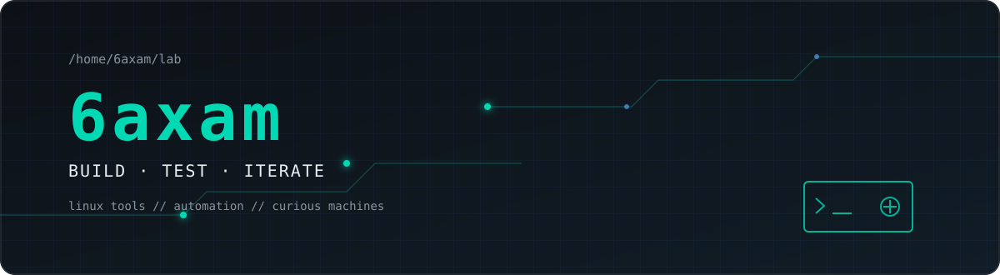

<picture>
  <source media="(prefers-color-scheme: dark)" srcset="./assets/banner.svg">
  <source media="(prefers-color-scheme: light)" srcset="./assets/banner.svg">
  
</picture>

 

### Linux • Automation • AI • Robotics • Open Source

I’m a student developer building small, practical systems and tools — mostly for Linux.  
I’m exploring automation, robotics, AI-assisted workflows, terminal interfaces, and the places where software meets hardware.

[Projects](#featured-projects) · [Stack](#working-stack) · [Focus](#current-focus)

## Featured projects

<table>
<tr>
<td width="50%" valign="top">

### [CADPisun](https://github.com/6axam/CADPisun)

PySide6 desktop tooling for deterministic single-line handwriting on A4, SVG export, and validated virtual G-code simulation.

`Python` `PySide6` `SVG` `G-code` `plotter`

**Status:** active engineering project; the current pipeline is local/offline and targets virtual simulation, not a physical machine.

</td>
<td width="50%" valign="top">

### [LyricTTY](https://github.com/6axam/LyricTTY)

A Linux terminal player with synchronized lyrics, artwork-driven colors, optional local word alignment, and CAVA visualization.

`Rust` `Ratatui` `MPRIS` `mpv` `CAVA`

**Status:** pre-release and under active development.

</td>
</tr>
<tr>
<td width="50%" valign="top">

### [Phoenix](https://github.com/6axam/Phoenix)

Local visual session snapshots and recovery for Hyprland, with SQLite history, optional Kitty state, and no telemetry.

`Python` `Hyprland` `GTK4` `SQLite`

**Status:** early alpha; tested around Omarchy/Hyprland with recovery depending on installed applications.

</td>
<td width="50%" valign="top">

### [X-Hunter](https://github.com/6axam/X-Hunter)

A Telegram bot and Mini App for tracking OLX.ua listings, applying price/text rules, and notifying about new or cheaper finds.

`Python` `Telegram` `Docker` `PostgreSQL` `Redis`

**Status:** local development workflow documented; long-running OLX availability is intentionally not claimed.

</td>
</tr>
</table>

## Other projects

- [Zapataya](https://github.com/6axam/Zapataya) — a Rust comma-key sound utility for Windows, macOS, Linux, and an Omarchy/Hyprland integration.
- [Jarvis-xyi](https://github.com/6axam/Jarvis-xyi) — a local Linux voice/text assistant with a registered-tool loop and optional OpenRouter integration.
- [Industrialist Production Calculator](https://github.com/6axam/Industrialist-Production-Calculator) — a React/TypeScript flowchart calculator and factory solver for the Roblox game Industrialist.
- [touch-grass-please](https://github.com/6axam/touch-grass-please) — a tiny terminal game about moving a mouse through grass.

## Working stack

| Area | Tools I use in projects |
| --- | --- |
| Languages | Python · Rust · TypeScript · JavaScript · Shell |
| Linux & infrastructure | Linux · Hyprland · Docker Compose · SQLite · PostgreSQL · Redis |
| Frameworks & tools | PySide6 · GTK4/PyGObject · React · Vite · Ratatui · Git |
| AI & automation | OpenRouter-compatible APIs · Whisper-based local alignment · Telegram bots · tool-driven assistants |
| Electronics & robotics | ESP32-S3 · BLE · Web Serial · plotter workflows · SVG/G-code |

## GitHub activity

<picture>
  <source media="(prefers-color-scheme: dark)" srcset="https://github-readme-stats.vercel.app/api?username=6axam&show_icons=true&hide_border=true&bg_color=0D1117&title_color=00D9B4&icon_color=58A6FF&text_color=E6EDF3">
  <source media="(prefers-color-scheme: light)" srcset="https://github-readme-stats.vercel.app/api?username=6axam&show_icons=true&hide_border=true&bg_color=ffffff&title_color=087f6b&icon_color=0969da&text_color=24292f">
  
</picture>
<picture>
  <source media="(prefers-color-scheme: dark)" srcset="https://github-readme-stats.vercel.app/api/top-langs/?username=6axam&layout=compact&hide_border=true&bg_color=0D1117&title_color=00D9B4&text_color=E6EDF3">
  <source media="(prefers-color-scheme: light)" srcset="https://github-readme-stats.vercel.app/api/top-langs/?username=6axam&layout=compact&hide_border=true&bg_color=ffffff&title_color=087f6b&text_color=24292f">
  
</picture>

> If a dynamic card is unavailable, the repositories and contribution graph remain the source of truth.

## Current focus

- Handwriting and plotter automation
- Linux session restoration
- Terminal applications
- AI-assisted tools

## Contact

The best way to see what I’m working on is to follow the repositories above. Issues and focused technical discussions are welcome.

`$ systemctl --user status curiosity.service`

built in small iterations · documented when it matters · shipped when it works

